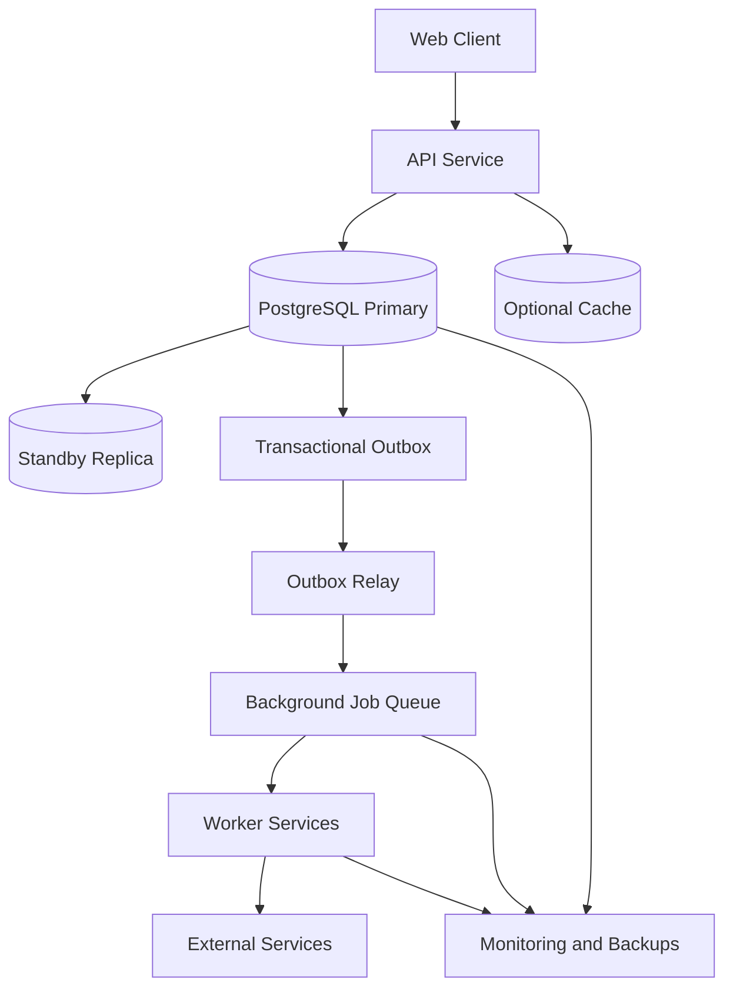
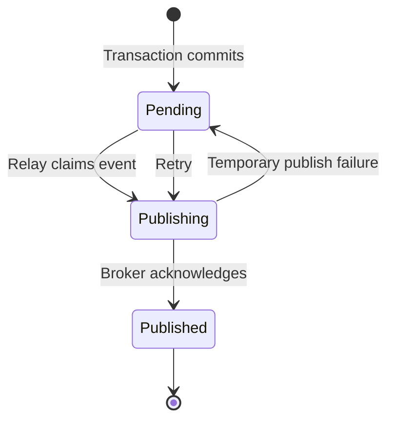

# QuickNotes — System Architecture

## 1. Overview

QuickNotes is a note-taking application used to explore API design, data modeling, system architecture, and reliability engineering.

The current implementation is a frontend practice client. It communicates with JSONPlaceholder for demonstration purposes. The database, transactional outbox, worker queue, automated failover, and production infrastructure described below are **proposed production architecture**, not features currently implemented in the frontend.

The design aims to preserve data consistency, support horizontal scaling, recover from infrastructure failures, and avoid losing background work when individual services become unavailable.

## 2. Requirements and Capacity Planning

### Functional requirements

* Retrieve and display notes.
* Create a note through an API request.
* Delete a note.
* Validate requests and return meaningful errors.
* Trigger background processing when a note is created.
* Maintain consistency between persisted notes and background-processing events.

### Non-functional requirements

* Reliability and recoverability.
* Atomic writes for related database records.
* Idempotent handling of retried operations.
* Horizontal scalability for API and worker services.
* Observability through logs, metrics, and alerts.
* Controlled database failover and backup recovery.

### Illustrative capacity estimates

Assume the system eventually supports:

* 1,000,000 registered users.
* 100,000 daily active users.
* 20 note reads per active user per day.
* One note creation per active user per day.
* An average note size of 2 KB.
* Peak traffic approximately five times the average rate.

| Metric                           |            Estimate |
| -------------------------------- | ------------------: |
| Daily note reads                 |           2,000,000 |
| Average reads per second         |               23.15 |
| Estimated peak reads per second  |              115.74 |
| Daily note creations             |             100,000 |
| Average writes per second        |                1.16 |
| Estimated peak writes per second |                5.79 |
| Raw storage growth per year      | Approximately 73 GB |

These are planning assumptions rather than measured production traffic. Actual capacity depends on request patterns, indexes, metadata, replication, backups, retention, and note-size distribution.

## 3. High-Level Architecture



The outbox is a logical table stored in the same database transaction as the note. It is not a separate database or an independent write to a message broker.

### Component responsibilities

* **Web client:** Collects input, sends API requests, and displays results.
* **API service:** Authenticates requests, validates data, applies business rules, and coordinates database transactions.
* **PostgreSQL:** Stores notes and outbox records durably.
* **Standby replica:** Receives database replication updates and may be promoted during a primary failure.
* **Outbox relay:** Finds committed, unpublished outbox events and forwards them to the message broker.
* **Message broker:** Holds jobs until workers process them.
* **Workers:** Perform asynchronous tasks such as notifications, indexing, or other post-creation processing.
* **Monitoring and backups:** Track failures, detect unhealthy components, and support recovery.

## 4. GET `/notes` Request Flow

1. The client sends `GET /notes`.
2. The API authenticates and authorizes the request where required.
3. The API validates query parameters such as pagination, filtering, and sorting.
4. The service reads the requested notes from PostgreSQL or an optional cache.
5. The API returns the requested notes with an appropriate HTTP status.
6. Errors are logged with a correlation ID, without exposing sensitive information.

Pagination should use a stable ordering, such as creation time plus a unique identifier, to reduce inconsistent results while the dataset changes.

## 5. POST `/notes` Request Flow

A note creation request must preserve consistency between the note itself and the event that announces its creation.

A naive implementation may perform two independent writes:

1. Insert the note into the database.
2. Publish a `NoteCreated` event to a message broker.

This creates a failure window. The database write may succeed while the broker publish fails. The note exists, but downstream processing never learns about it.

The transactional outbox pattern addresses this problem by storing the note and its event in the **same database transaction**.

### 5.1 Step-by-step atomic transaction

Suppose the client sends:

```http
POST /notes
Content-Type: application/json
Idempotency-Key: 8e0c9f3a-example
```

Example request body:

```json
{
  "title": "System Design",
  "content": "Understand atomic transactions."
}
```

The API executes the following sequence.

**Step 1 — Validate the request**

The API checks the request body, required fields, field lengths, authorization, and any applicable business rules. Invalid input is rejected before a database transaction begins.

**Step 2 — Begin the database transaction**

PostgreSQL opens a transaction. The note and its outbox event will be committed or rolled back as a unit.

**Step 3 — Insert the note**

The API inserts the note and obtains its generated identifier.

```sql
INSERT INTO notes (id, title, content, created_at)
VALUES (
    :note_id,
    :title,
    :content,
    CURRENT_TIMESTAMP
);
```

Here, `:note_id`, `:title`, and `:content` represent application-supplied parameters. Production code must use parameterized queries rather than constructing SQL by concatenating user input.

**Step 4 — Insert the corresponding outbox event**

Within the *same transaction*, the API writes an event describing the newly created note.

```sql
INSERT INTO outbox_events (
    event_id,
    aggregate_type,
    aggregate_id,
    event_type,
    payload,
    created_at,
    published_at,
    attempts
)
VALUES (
    :event_id,
    'note',
    :note_id,
    'NoteCreated',
    :event_payload,
    CURRENT_TIMESTAMP,
    NULL,
    0
);
```

The payload may contain the event ID, note ID, and the minimum metadata required by downstream consumers. Avoid putting secrets or unnecessary personal information into events.

**Step 5 — Commit both writes**

```sql
COMMIT;
```

The transaction becomes durable according to the configured PostgreSQL durability settings. Both the note and its outbox event become committed together.

If either insert fails, or the transaction cannot commit, the application rolls back:

```sql
ROLLBACK;
```

The rollback removes both uncommitted changes. The application must not return a successful creation response unless it knows the transaction committed.

**Step 6 — Return the API response**

After a confirmed commit, the API returns `201 Created`, including the created note or its identifier.

The API does not need to wait for the worker to finish processing the event. Background processing happens asynchronously.

### 5.2 Transaction pseudocode

The application-level logic can be expressed as:

```text
function createNote(request):
    validate(request)

    begin database transaction

    try:
        note = insertNote(request.title, request.content)

        event = createNoteCreatedEvent(note)

        insertOutboxEvent(event)

        commit transaction

        return HTTP 201 with note
    catch error:
        rollback transaction
        report error
        return appropriate failure response
```

The note insertion and outbox insertion must use the **same database connection and transaction**. Starting a separate transaction for the outbox defeats the atomicity guarantee.

This is conceptual pseudocode; it is not the current frontend's implementation.

### 5.3 Why this prevents data discrepancies

| Failure scenario                                    | Expected outcome                                                                              |
| --------------------------------------------------- | --------------------------------------------------------------------------------------------- |
| Note insert fails                                   | No note or outbox event is committed.                                                         |
| Note insert succeeds, outbox insert fails           | The transaction rolls back; neither record is committed.                                      |
| Both inserts succeed, commit succeeds               | Both records are committed.                                                                   |
| Application crashes before commit                   | PostgreSQL rolls back the uncommitted transaction during recovery.                            |
| API loses its connection during commit              | The outcome may be uncertain to the API; it must reconcile or safely retry using idempotency. |
| Database commits, but the API response is lost      | The client may retry; an idempotency mechanism prevents an unintended duplicate note.         |
| Broker is unavailable after the transaction commits | The note and outbox event remain stored; the relay retries publication later.                 |

The key guarantee is **atomic database persistence**, not atomic delivery to the message broker. The outbox relay and worker are responsible for reliable delivery and processing after the database transaction commits.

### 5.4 Idempotency and ambiguous commit outcomes

A connection failure during `COMMIT` does not necessarily mean the transaction failed. PostgreSQL may have committed successfully before the connection was lost.

To prevent duplicate notes, the API can accept an idempotency key and persist it in an idempotency table or alongside the operation, protected by a unique constraint.

On a retry, the API checks the existing operation and returns its previous result instead of repeating the creation. The idempotency record must be managed consistently with the note transaction.

A unique event ID also helps downstream consumers identify duplicate event deliveries.

## 6. Outbox Relay and Background Worker Flow

The transactional outbox solves the database-to-event consistency problem. A separate relay is responsible for publishing committed outbox events to the broker.

### 6.1 Publishing an event

1. The relay searches for committed outbox events that have not been published.
2. It claims a batch of eligible events, using a lease or row-locking strategy to coordinate multiple relay instances.
3. It publishes each event to the message broker.
4. After the broker acknowledges publication, the relay marks the event as published.
5. If publication fails, the event remains eligible for retry after the lease or retry delay expires.

The relay must not mark an event as published before receiving the broker's acknowledgement. Otherwise, a broker failure could cause an event to be lost.

There is also a failure window in the opposite direction: the broker may accept an event, but the relay may crash before marking the database row as published. The relay may publish that event again.

Consequently, the outbox normally provides **at-least-once delivery**, not exactly-once delivery. Duplicate-safe consumers are essential.

### 6.2 Worker queue retries

Workers consume jobs from the message broker and process them independently of the API request.

A robust worker should:

1. Receive a job with a stable event or job ID.
2. Check whether the operation has already been processed.
3. Execute the work.
4. Record successful completion.
5. Acknowledge the job only after the required work and completion record are safely persisted.

For transient failures, the queue retries the job using exponential backoff with jitter. For example, retry delays could increase approximately from 1 second to 2, 4, 8, and 16 seconds, with random variation. These values are illustrative and should be tuned to the service.

Each job should have a maximum retry count or age limit. Jobs that repeatedly fail are moved to a dead-letter queue for investigation and controlled replay.

### 6.3 Handling worker crashes

If a worker crashes after receiving a job but before acknowledging it, a broker visibility timeout or job lease allows the job to become available again.

The next worker may receive the same job. Therefore, the worker should use idempotent operations, unique processing records, or downstream idempotency keys to avoid duplicate side effects.

For example, if `NoteCreated` triggers a notification, the notification service should record a stable notification or event ID so repeated processing does not send the same notification multiple times.

### 6.4 Outbox event lifecycle



This is a simplified lifecycle. A production implementation should also represent leases, retry schedules, permanent failures, and dead-letter or manual-review states as needed.

## 7. Automated Database Failover

A PostgreSQL primary may become unavailable because of hardware failure, network partition, process crash, or storage problems. A standby replica and a reliable promotion process can reduce downtime.

### 7.1 Failover sequence

1. Health monitoring detects that the primary is unhealthy.
2. A failover controller evaluates whether the primary is genuinely unavailable and whether a safe promotion is possible.
3. The controller prevents the old primary from continuing to accept writes, using a fencing mechanism or equivalent cluster coordination.
4. An eligible standby is promoted to primary.
5. The database endpoint, proxy, or service discovery layer directs new connections to the promoted primary.
6. The application discards broken connections and establishes new connections.
7. Failed or ambiguous transactions are reconciled or retried safely using idempotency.
8. The former primary is reinitialized or rejoined as a standby only after its state is reconciled with the current primary.

Failover should be automated but guarded against split-brain, where two database instances both accept writes as primary.

### 7.2 Replication trade-offs

* **Synchronous replication:** Can reduce the risk of losing acknowledged transactions, depending on configuration, but may increase write latency and reduce availability when replicas cannot be reached.
* **Asynchronous replication:** Can improve write availability and latency, but a sudden primary failure may lose recently acknowledged transactions that had not reached the standby.

The recovery point objective (RPO) defines the acceptable data-loss window. The recovery time objective (RTO) defines the acceptable time to restore service. These targets must guide the replication and failover configuration.

A stable endpoint alone is not enough: applications need connection recovery, bounded retries, transaction reconciliation, and monitoring.

### 7.3 Backups and recovery

Replication is not a substitute for backups. Replication may copy accidental deletions or corrupted data to the standby.

Production operations should include:

* Automated backups and appropriate retention.
* Point-in-time recovery where supported.
* Periodic restore tests.
* Replication-lag monitoring.
* Alerts for failed backups and storage exhaustion.
* Documented failover and disaster-recovery procedures.

## 8. Single Points of Failure and Mitigations

| Component or risk        | Potential failure                  | Mitigation                                                |
| ------------------------ | ---------------------------------- | --------------------------------------------------------- |
| API instance             | Process crash or overload          | Multiple instances, health checks, load balancing         |
| Database primary         | Primary becomes unavailable        | Standby, controlled promotion, fencing, recovery testing  |
| Replication              | Excessive lag or standby failure   | Lag monitoring, alerts, tested recovery procedures        |
| Database connection pool | Connection exhaustion              | Pool limits, timeouts, backpressure                       |
| Outbox relay             | Relay stops publishing events      | Multiple relay instances, leases, monitoring, retries     |
| Message broker           | Queue becomes unavailable          | Durable queues, suitable replication, bounded retries     |
| Worker instance          | Crash during processing            | Job leases, retry policy, idempotent processing           |
| External service         | Timeout or outage                  | Timeouts, backoff, circuit breakers, dead-letter handling |
| Cache                    | Stale or unavailable data          | Cache expiry, invalidation, database fallback             |
| Backup system            | Backup failure or unusable restore | Alerts and scheduled restore tests                        |

Retries must be bounded and coordinated. Aggressive retries during an outage can increase load and make recovery harder.

## 9. Data Model Considerations

A production PostgreSQL implementation may include the following logical tables.

### `notes`

* `id`: primary key.
* `title`: note title.
* `content`: note content.
* `created_at`: creation timestamp.
* `updated_at`: last update timestamp, if applicable.

### `outbox_events`

* `event_id`: unique event identifier.
* `aggregate_type`: entity type, such as `note`.
* `aggregate_id`: identifier of the affected note.
* `event_type`: event name, such as `NoteCreated`.
* `payload`: serialized event data.
* `created_at`: event creation timestamp.
* `published_at`: timestamp of successful broker publication, initially null.
* `attempts`: number of publication attempts.
* Additional lease and retry fields, if required by the relay design.

Useful indexes may include a unique index on `event_id` and an index supporting retrieval of unpublished events by publication status and creation time. Index choices should be based on actual query patterns and operational testing.

An idempotency table can store the idempotency key, operation status, and response reference, with a uniqueness constraint scoped to the appropriate client or account.

Retention policies should prevent the outbox and idempotency tables from growing without limit while preserving sufficient records for debugging and safe recovery.

## 10. Architectural Trade-offs

### PostgreSQL versus NoSQL

PostgreSQL is a strong default for this design because the note and outbox event require transactional consistency and relational constraints. It also supports indexes, structured querying, and mature recovery tooling.

A NoSQL database may be appropriate for different access patterns or scale requirements, but the design must establish whether its transaction and consistency guarantees support the same atomic note-plus-event operation.

### Synchronous work versus asynchronous work

Synchronous work gives the client an immediate result but increases request latency and ties API availability to downstream services.

Asynchronous work lets the API acknowledge a committed note without waiting for every downstream task. It introduces queue operations, eventual consistency for derived data, retries, monitoring, and duplicate-handling requirements.

### Transactional outbox versus direct publication

Directly publishing after a database commit is simpler but leaves a gap in which the database can commit while event publication fails.

The transactional outbox adds storage and relay complexity, but it durably records the intent to publish in the same transaction as the business change.

## 11. Observability and Operational Metrics

Production monitoring should include:

* API request rate, latency, and error rate.
* Database transaction failures and connection-pool saturation.
* Primary health, replication lag, and failover duration.
* Number and age of unpublished outbox events.
* Relay publication failures and retry counts.
* Queue depth, oldest job age, worker failure rate, and retry count.
* Dead-letter queue size.
* Backup completion and restore-test results.

Logs should carry correlation IDs, note IDs where appropriate, and event IDs. Sensitive note content should not be logged by default.

Alert thresholds should reflect the system's reliability targets rather than arbitrary values.

## 12. Conclusion

QuickNotes demonstrates how a simple note-taking workflow can evolve into a resilient distributed system.

The central consistency principle is that the note and its outbox event must be inserted within the same database transaction. If either write fails, the transaction rolls back. Once committed, the outbox relay can retry publication independently, while queue workers use bounded retries, durable job handling, and idempotency to manage failures.

Database failover, message delivery, and background processing each have separate failure modes. Combining atomic database transactions, a transactional outbox, safe retry behavior, observability, and tested recovery procedures reduces data discrepancies and improves reliability.

**Implementation status:** The current QuickNotes frontend uses JSONPlaceholder as a demonstration API. The PostgreSQL transaction, transactional outbox, message broker, worker queue, and automated failover described here are proposed architectural designs, not implemented features of the current project.
