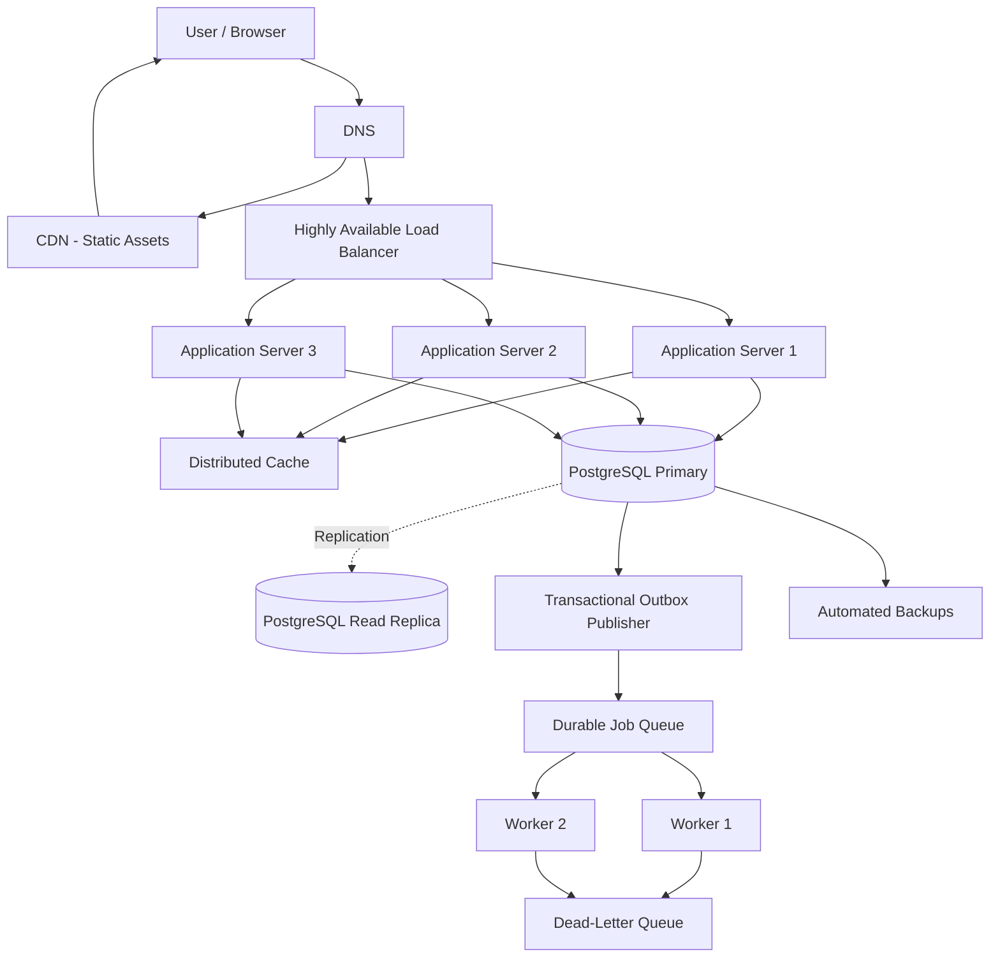

# QuickNotes System Architecture

## 1. Overview

QuickNotes is a lightweight note-taking application designed to demonstrate how a web application can evolve from a simple client into a scalable, resilient system.

The current frontend uses HTML, CSS, and JavaScript to communicate with the JSONPlaceholder practice API. The architecture described in this document represents a proposed production design for a real QuickNotes backend.

The production architecture separates the presentation layer, application services, data storage, caching, and asynchronous processing so each component can scale independently.

## 2. Functional Requirements

The system should support the following capabilities:

* Retrieve and display notes.
* Create notes with a required title and an optional body.
* Retrieve an individual note by ID.
* Update existing notes.
* Delete notes.
* Associate notes with users.
* Validate incoming requests and return meaningful errors.
* Process non-critical background tasks asynchronously.
* Preserve note data during application and infrastructure failures.

## 3. Non-Functional Requirements

* **Availability:** Multiple application instances should continue serving requests if one instance fails.
* **Scalability:** Application servers and workers should scale horizontally as demand increases.
* **Performance:** Frequently requested data should be served efficiently through caching and database indexing.
* **Durability:** Committed notes should be stored in persistent database storage with backups and recovery procedures.
* **Security:** Use HTTPS, authentication, authorization, input validation, and rate limiting.
* **Maintainability:** Keep application responsibilities separated and expose clear API contracts.
* **Observability:** Collect application logs, health metrics, request latency, database health, and background-job failures.

## 4. Capacity Planning and Load Estimates

For this design, assume the application has 1,000,000 registered users.

### Planning assumptions

| Metric                         |    Assumption |
| ------------------------------ | ------------: |
| Registered users               |     1,000,000 |
| Daily active users             | 100,000 (10%) |
| Reads per active user per day  |            20 |
| Writes per active user per day |             1 |
| Average stored note size       |          2 KB |
| Peak-to-average traffic ratio  |           5:1 |
| Days per year                  |           365 |

These figures are planning assumptions, not measured production traffic.

### Read throughput

Daily reads:

100,000 × 20 = 2,000,000 reads/day

Average read throughput:

2,000,000 ÷ 86,400 ≈ 23.15 reads/second

Estimated peak throughput:

23.15 × 5 ≈ 115.74 reads/second

### Write throughput

Daily writes:

100,000 × 1 = 100,000 writes/day

Average write throughput:

100,000 ÷ 86,400 ≈ 1.16 writes/second

Estimated peak throughput:

1.16 × 5 ≈ 5.79 writes/second

### Annual storage estimate

Assuming each user creates one note per active day:

100,000 × 2 KB × 365 = 73,000,000 KB/year

This is approximately 73 GB per year using decimal units.

The estimate excludes indexes, database overhead, replicas, backups, logs, and any growth in note size.

### Workload characteristics

QuickNotes is expected to be read-heavy, with substantially more reads than writes. Caching and read replicas can improve read performance, while the primary database remains responsible for authoritative writes.

## 5. High-Level Architecture



The diagram represents a proposed production architecture. The primary-to-replica connection represents database replication; the outbox publisher and queue represent asynchronous processing.

## 6. Component Responsibilities

### Client

The browser displays the interface, validates basic user input, submits API requests, and presents loading, success, empty, and error states.

Client-side validation improves usability but does not replace server-side validation.

### DNS

DNS resolves the application's domain to the appropriate infrastructure endpoints. Production deployments should use reliable DNS hosting and health-aware routing where appropriate.

### CDN

The content delivery network caches static resources such as HTML, CSS, JavaScript, images, and fonts near users. Dynamic API requests are routed to the backend rather than treated as static assets.

### Load Balancer

The load balancer distributes API traffic among healthy application servers. Health checks remove unhealthy instances from rotation, while redundant or managed load-balancing infrastructure reduces the risk of a single load balancer becoming a failure point.

### Application Servers

Multiple stateless application instances process HTTP requests, enforce validation and authorization, execute business logic, and communicate with the database, cache, and queue.

Because the instances are stateless, additional servers can be introduced without moving user sessions between them.

### Distributed Cache

The cache stores frequently requested data, such as note lists, to reduce database load and response latency.

The database remains the source of truth. Cache entries should be invalidated or updated after successful writes, and cache failures should not cause the system to lose authoritative data.

### PostgreSQL Primary

The primary database stores authoritative note and user records and handles transactions and writes. Database constraints enforce data integrity.

### PostgreSQL Read Replica

A read replica receives replicated changes from the primary and can serve eligible read queries. Replication lag means a replica may briefly return stale data, so reads requiring immediate consistency should use the primary.

### Durable Job Queue

The queue holds asynchronous work that should not delay the main API response. It decouples request handling from background processing and supports controlled retries.

### Workers

Workers process queued jobs, such as notifications and other non-critical tasks. Multiple workers can run concurrently to improve throughput and resilience.

### Backups

Automated backups and point-in-time recovery protect against accidental deletion, data corruption, and failures that replication alone cannot correct.

## 7. GET `/notes` Request Flow

1. The client sends `GET /notes` over HTTPS.
2. DNS resolves the application domain, and the load balancer routes the request to a healthy application server.
3. The server authenticates and authorizes the request where required and validates pagination and filter parameters.
4. The server checks the cache for a suitable note-list entry.
5. On a cache hit, the server returns the cached result if it is valid for the request.
6. On a cache miss, the server queries PostgreSQL. Eligible reads can use a healthy read replica; reads requiring strong read-after-write consistency use the primary.
7. The server returns the requested notes with an appropriate HTTP status, normally `200 OK`.
8. If caching is enabled, the result is cached according to the configured expiration and invalidation policy.

If a database or application failure prevents the request from completing, the API returns an appropriate error rather than returning fabricated data.

## 8. POST `/notes` Request Flow

The POST flow creates a note while preserving data integrity and providing clear failure handling.

### Step 1: Client submission

The user enters a title and optional body and submits the form.

The client checks that the title is present and no longer than 100 characters, disables the submit button while the request is running, and sends a request such as:

```http
POST /notes
Content-Type: application/json
```

Example request body:

```json
{
  "title": "System design notes",
  "body": "Review caching, replication, and queue retries.",
  "userId": 1
}
```

In a production system, the authenticated identity should determine the owner. The server must not trust a client-supplied `userId` as proof of ownership.

### Step 2: Request routing

DNS resolves the domain, and the load balancer routes the request to a healthy application instance. HTTPS protects the request in transit.

### Step 3: Validation and authorization

The application validates the request body, verifies the user's identity and permissions, and applies rate limits.

Invalid input receives `400 Bad Request`; missing or invalid authentication receives `401 Unauthorized`, while insufficient permissions receive `403 Forbidden`.

No database write occurs for a request that fails validation or authorization.

### Step 4: Database transaction

The application begins a PostgreSQL transaction against the current primary and inserts the note with its owner ID and timestamps.

The database enforces relevant constraints. The transaction commits before the application reports successful creation.

If the transaction fails, the application rolls it back and returns an appropriate error.

### Step 5: Cache invalidation

After a successful commit, affected note-list cache entries are invalidated or updated.

If cache invalidation fails, the application records the failure for retry or relies on a short cache time-to-live to limit stale results. The cache is not treated as the authoritative store.

### Step 6: Publish background work

If creating a note triggers asynchronous work, such as a notification, the application schedules a background job.

Where reliable coordination is required, the application writes an outbox record in the same database transaction as the note. A separate publisher sends pending outbox records to the durable queue and marks them as published after successful delivery.

This prevents an application crash between the database commit and queue publication from silently losing the associated job.

### Step 7: Return the response

The API returns `201 Created` with the new note's ID and representation.

The client displays the created note, clears the form, and shows a success message.

If the request fails, the client presents an appropriate error instead of claiming the note was saved.

### Step 8: Handle ambiguous outcomes

A network failure can occur after the database commits but before the client receives the response. The client may not know whether the note was created.

Production clients should not blindly repeat an ambiguous POST request. An idempotency key can allow the server to recognize a retry of the same operation and avoid creating duplicate notes.

## 9. Automated Database Primary Failover

The PostgreSQL primary handles authoritative writes, while a standby replica receives replicated changes. A production deployment should use a database high-availability service or cluster manager to coordinate automated failover.

### Health monitoring

The cluster manager monitors primary health, connectivity, and replication status. A sustained failure triggers a controlled failover process.

A single failed health check should not automatically trigger promotion because temporary network problems can make a healthy primary appear unavailable.

### Standby promotion

When the primary is confirmed unavailable and split-brain safeguards are satisfied, the cluster manager selects an eligible standby and promotes it to become the new primary.

The potential for data loss depends on replication mode:

* **Synchronous replication** can reduce the risk of losing acknowledged writes, depending on the configured commit and acknowledgment policy.
* **Asynchronous replication** generally reduces write latency but may lose recent transactions that had not reached the standby when the primary failed.

### Connection recovery

Applications connect through a stable database endpoint or proxy that identifies the current primary.

After failover:

1. Existing database connections may break.
2. Application connection pools discard broken connections.
3. Clients reconnect to the current primary using bounded retries and backoff.
4. In-flight transactions are treated as potentially failed and are retried only when doing so is safe.
5. Requests return an appropriate temporary error if the database is not yet available.

### Preventing split-brain writes

Only one database node should accept authoritative writes at a time.

Quorum controls, fencing, or equivalent cluster coordination prevent an isolated former primary from continuing to accept writes after another node has been promoted. Without these safeguards, independent primaries could accept conflicting changes.

### Recovery and rejoining

After the failed primary is repaired, it must be reconciled with the active cluster and rejoined as a replica. It must not resume primary status without cluster coordination.

### Monitoring and recovery objectives

Monitor:

* Primary and replica availability.
* Replication lag.
* Failover duration.
* Failed database connections.
* Recovery time and recovery point objectives.
* Backup completion and restoration success.

Automated failover improves availability but does not guarantee zero downtime or zero data loss. Backups and point-in-time recovery remain necessary because replication can reproduce accidental deletions or corrupted changes.

## 10. Worker Queue Retries and Background Job Recovery

Background work should run outside the synchronous API request whenever it is safe to do so. This keeps request latency predictable and allows worker capacity to scale independently.

### 10.1 Enqueue the job

After the relevant database transaction commits, a publisher sends the job to a durable queue.

For workflows that require reliable coordination between a database write and queue publication, the transactional outbox records the intended job in the same database transaction as the business change.

The publisher retries unsuccessful deliveries and marks an outbox record as published only after the queue has acknowledged the message. If the publisher crashes after delivery but before marking the record, the job may be delivered again; consumers must therefore tolerate duplicates.

### 10.2 Claim and process

A worker claims a job using a lease, visibility timeout, or equivalent queue mechanism.

The worker acknowledges the job only after successful processing. If it crashes or its lease expires before completion, the queue makes the job eligible for processing again.

### 10.3 Retry transient failures

Temporary network errors, service unavailability, and rate limits can be retried automatically.

Use exponential backoff with jitter. For example, the approximate retry delays might be 1, 2, 4, 8, and 16 seconds, with random variation and a configured maximum delay.

Respect a downstream service's `Retry-After` instruction when applicable.

Backoff and jitter help prevent many workers from retrying simultaneously and creating a retry storm.

### 10.4 Bound retries

Each job should have a configured maximum attempt count and maximum age.

Transient failures may be retried, while permanent errors—such as an invalid payload—should not be retried indefinitely.

When a job exhausts its retry budget, route it to a dead-letter queue or equivalent failure store. Record its ID, attempt count, timestamps, and failure reason so an operator can investigate the underlying cause.

### 10.5 Prevent duplicate side effects

Most durable queues provide at-least-once delivery, which means the same job may be delivered more than once.

Workers must therefore be idempotent. Depending on the operation, this can include:

* Using a stable job ID or idempotency key.
* Recording completed operations.
* Applying unique database constraints.
* Checking whether a side effect has already occurred before repeating it.
* Using downstream APIs that support idempotency keys.

For example, retrying a notification job should not create duplicate records or send repeated messages unnecessarily.

### 10.6 Handle queue outages

If the queue becomes unavailable, the publisher retries with bounded backoff.

A transactional outbox preserves pending work in the database until publication succeeds. Monitoring should alert operators if the outbox grows continuously or pending jobs exceed their expected processing time.

The API should not wait indefinitely for non-critical background work. Its synchronous response should reflect the outcome of the primary business transaction, not the completion of every downstream task.

### 10.7 Monitor and recover

Monitor queue depth, oldest-job age, worker health, processing duration, retry counts, dead-letter volume, and failure rate.

Operators should investigate the underlying cause before replaying dead-lettered jobs. Replay should be controlled and idempotent to avoid duplicating side effects.

## 11. Single Points of Failure and Resilience

A single point of failure (SPOF) is a component whose failure can make the entire application or a critical function unavailable.

| Component           | Failure risk                                                 | Mitigation                                                                                                           |
| ------------------- | ------------------------------------------------------------ | -------------------------------------------------------------------------------------------------------------------- |
| Application server  | A crashed instance stops serving requests.                   | Run multiple instances behind a load balancer with health checks.                                                    |
| Load balancer       | A single load-balancing instance can interrupt API access.   | Use a managed or redundant load-balancing service.                                                                   |
| PostgreSQL primary  | Writes fail while the primary is unavailable.                | Maintain a replicated standby and use a cluster manager for controlled automated failover.                           |
| Read replica        | Read capacity decreases or replica reads become unavailable. | Route reads to healthy replicas or fall back to the primary when safe and capacity permits.                          |
| Cache               | Cached reads fail or response times increase.                | Treat PostgreSQL as the source of truth and use bounded timeouts and safe fallback behavior.                         |
| Job queue           | Background processing pauses or jobs cannot be published.    | Use durable queue infrastructure, publisher retries, and a transactional outbox where reliable delivery is required. |
| Worker              | A worker crash leaves jobs unfinished.                       | Run multiple workers and use leases or visibility timeouts so unfinished jobs can be retried.                        |
| Storage and backups | Data loss or corruption affects recovery.                    | Use durable storage, automated backups, point-in-time recovery, and tested restoration procedures.                   |
| Monitoring service  | Failures may go undetected.                                  | Use independent monitoring and alerting paths where practical.                                                       |

### Important resilience trade-offs

Redundancy improves availability but increases infrastructure cost and operational complexity.

Database replication lag can produce stale reads. Asynchronous replication may lose recent acknowledged writes during failover, while synchronous replication can increase write latency or reduce write availability if the required replicas cannot acknowledge commits.

Retries improve resilience but can increase load during an outage. Exponential backoff, jitter, bounded attempts, and circuit breakers help prevent retry storms.

Caching improves read performance but introduces invalidation complexity and potential staleness.

Automated failover and queue retries are proposed production design features. They are not implemented by the current static frontend, which uses JSONPlaceholder as a practice API.

## 12. Design Trade-offs

### SQL versus NoSQL

PostgreSQL is suitable for QuickNotes because notes have clear ownership relationships and benefit from transactions, relational constraints, and structured queries.

A document-oriented database could also store notes, but it would not automatically provide a better solution for this workload. The choice should follow access patterns, consistency requirements, operational expertise, and scaling needs.

### Cache versus database reads

Caching reduces database load and latency for frequently requested data. However, cache invalidation and expiration rules must be designed carefully to avoid serving stale results.

### Synchronous versus asynchronous processing

Synchronous processing is appropriate for operations whose outcome must be known before returning a response, such as committing a note.

Asynchronous processing is appropriate for work that can happen later, such as notifications. It improves responsiveness but requires durable queues, retries, idempotency, and monitoring.

### Read replicas versus primary reads

Read replicas increase read capacity but can lag behind the primary. The application must decide which reads can tolerate eventual consistency and which require immediate consistency.

## 13. Conclusion

QuickNotes begins as a small browser-based application but can evolve into a scalable production system by separating responsibilities across application servers, databases, caches, and background workers.

Horizontal scaling reduces dependence on individual application instances. Database replication and automated failover improve write availability. Durable queues, bounded retries, idempotent workers, and dead-letter handling improve background-job resilience. Automated backups and tested recovery procedures protect data beyond what replication alone can guarantee.

These design choices provide a practical foundation for scaling the application while making the trade-offs in availability, consistency, performance, and operational complexity explicit.
